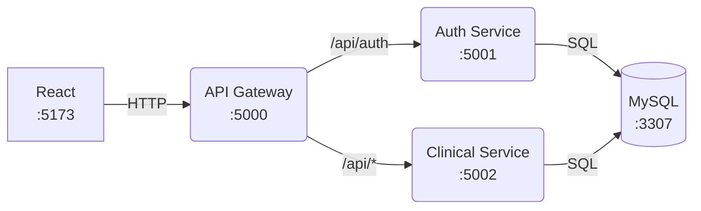

markdown
# 🏥 HealthGuard Pro - Sistema de Monitoreo Médico

**Proyecto Integrador - Maestría en Sistemas Computacionales**  
*Instituto Tecnológico de Estudios Superiores de Zamora (ITESZ)*  
*Materias: Arquitectura Orientada a Servicios / Lenguajes Web*

HealthGuard Pro es una plataforma web diseñada para la gestión clínica y el monitoreo de pacientes. El sistema implementa una **Arquitectura de Microservicios**, garantizando escalabilidad, seguridad y un despliegue automatizado con Docker.

---

## 🏗️ Arquitectura del Sistema

El proyecto está construido bajo los siguientes componentes:

1. **Frontend (React + Vite):** Interfaz de usuario implementando el patrón **MVVM** (Model-View-ViewModel) mediante el uso de `Context API` para el manejo del estado y Axios con interceptores para el consumo de la API.
2. **API Gateway (Flask + HTTPX):** Punto de entrada único que recibe las peticiones del frontend y las enruta al microservicio correspondiente.
3. **Auth Service (Flask):** Microservicio encargado de la identidad, autenticación (JWT), control de acceso basado en roles (RBAC), gestión de usuarios y Rate Limiting.
4. **Clinical Service (Flask):** Microservicio central que gestiona pacientes, expedientes clínicos, signos vitales y generación de alertas médicas.
5. **Base de Datos (MySQL 8):** Almacenamiento relacional con integridad referencial (PK, FK, Checks), vistas, Procedimientos Almacenados y auditoría automática.
6. **Orquestación (Docker Compose):** Contenerización de todos los servicios para un despliegue con un solo comando.

### Diagrama de Flujo de Peticiones


```
    


🛠️ Tecnologías Utilizadas
Frontend: React 18, React Router DOM, Axios, Context API (MVVM).

Backend: Python 3.11, Flask, SQLAlchemy, PyMySQL.

Seguridad: JSON Web Tokens (JWT), Flask-JWT-Extended, Flask-Limiter (Rate Limit).

Base de Datos: MySQL 8.0 (Vistas, Procedimientos Almacenados, Auditoría JSON).

DevOps: Docker, Docker Compose, Nginx (para servir el frontend).

CI/CD: GitHub Actions (Pruebas automatizadas con Pytest).

🚀 Guía de Instalación y Despliegue Local
Prerrequisitos
Tener instalado Docker Desktop.

Tener instalado Git (opcional, para clonar el repositorio).

Pasos para levantar el sistema
Clona el repositorio o descarga el código fuente.

Abre una terminal en la raíz del proyecto (donde se encuentra el archivo docker-compose.yml).

Ejecuta el siguiente comando para construir y levantar todos los contenedores:

bash
docker-compose up -d --build
Espera aproximadamente 30 segundos (mientras MySQL inicializa las tablas y ejecuta el script init.sql).

Abre tu navegador y accede a:
👉 http://localhost:5173

Nota: El sistema ya incluye la carga inicial de datos (db/init.sql) con usuarios de prueba listos para usar.

🔐 Credenciales de Prueba
Todas las cuentas tienen la contraseña: admin123

Rol	Email	Nivel de Acceso
Administrador	admin@hospital.com	Acceso total (Dashboard, Usuarios, Auditoría)
Médico	carlos.rodriguez@hospital.com	Pacientes, Signos Vitales, Historial Clínico
Enfermero	ana.martinez@hospital.com	Registro de Signos, Gestión de Alertas
Paciente	juan.perez@email.com	Solo lectura de sus propios signos y alertas
🧪 Pruebas Automatizadas (CI/CD)
El proyecto cuenta con un flujo de Integración Continua (CI) configurado en GitHub Actions (.github/workflows/ci.yml).

Cada vez que se realiza un push a la rama main, GitHub:

Instala Python 3.11.

Instala las dependencias del auth-service.

Ejecuta las 4 pruebas unitarias (Login exitoso, Login fallido, Bloqueo por intentos, Registro).

Para ejecutar las pruebas localmente:

bash
cd healthguard-services/auth-service
python -m pytest tests/ -v
📂 Estructura del Proyecto
text
/
├── .github/workflows/   # Configuración de GitHub Actions (CI)
├── DB/                  # Scripts SQL (init.sql con tablas, SPs, vistas y datos)
├── healthguard-frontend/ # Código fuente de React (Vistas y ViewModels)
├── healthguard-services/
│   ├── api-gateway/     # Configuración del proxy inverso
│   ├── auth-service/    # Microservicio de Autenticación y Usuarios
│   └── clinical-service/ # Microservicio de Datos Clínicos
├── docker-compose.yml   # Orquestador de contenedores
└── README.md
📌 Funcionalidades Destacadas
☑ Autenticación con JWT y Control de Acceso Basado en Roles (RBAC).
☑ Rate Limiting para prevención de ataques de fuerza bruta en el login.
☑ CRUD completo de Pacientes (con validaciones y control de permisos).
☑ Registro y consulta de Signos Vitales mediante Procedimientos Almacenados.
☑ Historial Clínico con generación automática de notificaciones urgentes.
☑ Módulo de Gestión de Usuarios y asignación de roles.
☑ Módulo de "Mi Perfil" para el cambio de contraseña seguro.
☑ Bitácora de Auditoría (Logs de acciones del sistema).


☑ Dashboard Estadístico: Panel principal con tarjetas de resumen (Total de pacientes, Alertas activas).
☑ Autenticación y Seguridad: Login con JWT, Rate Limiting (5 intentos/min) y desbloqueo de cuentas por el administrador.
☑ Gestión de Usuarios: El administrador puede crear Médicos, Enfermeros y Pacientes asignándoles roles desde la interfaz, además de cambiar roles existentes.
☑ Umbrales Automáticos: Al crear un nuevo paciente, el sistema le asigna automáticamente sus límites médicos (Glucosa, Presión, etc.).
☑ Alertas Clínicas Automatizadas: Si un signo vital supera los umbrales del paciente, se genera una alerta de nivel "Crítico" o "Alerta".
☑ CRUD Completo: Gestión de Pacientes, Signos Vitales e Historial Clínico con validaciones de rangos.
☑ Auditoría: Bitácora de acciones críticas registradas automáticamente mediante Procedimientos Almacenados en MySQL.
☑ Vistas SQL: Implementación de 3 vistas para consultas complejas y desacoplamiento de la base de datos.
Desarrollado por: Ricardo Cesar Alonso Bravo.
